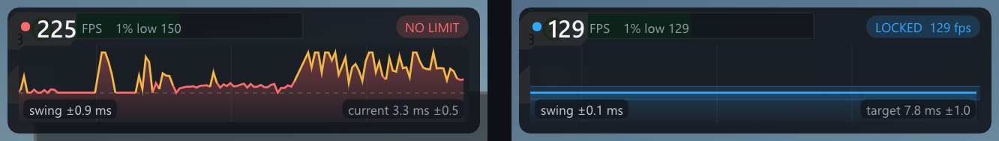
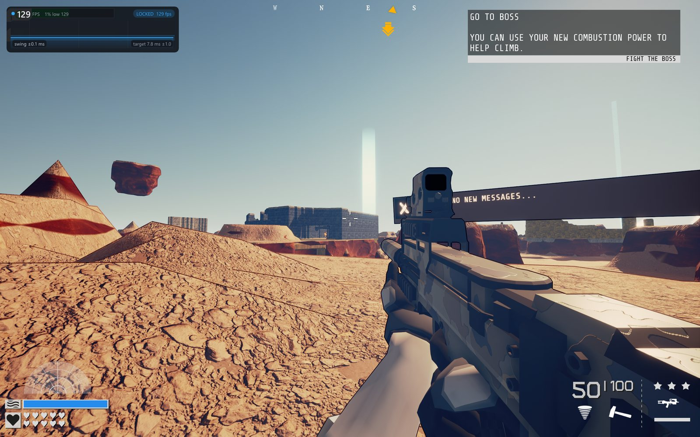
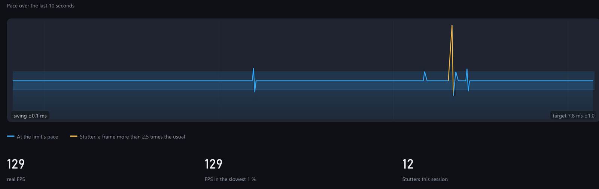
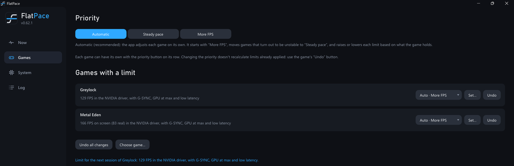

# FlatPace

**FlatPace mide tus juegos y aplica el límite de FPS que hace que vayan lo más estables posible.** La idea de fondo: un ritmo constante se siente más fluido que unos FPS más altos pero irregulares.

Versión actual: **0.62.2** · Windows 10 (1803 o posterior) y Windows 11 · [Guía de uso](GUIA.md) · [Documentación técnica](TECNICO.md) · [Historial de cambios](CHANGELOG.md) · [Licencia](LICENSE) · [English](README.md)



*El overlay en Greylock. Izquierda: sin límite, 225 FPS pero irregulares (variación del ritmo ±0,9 ms; el 1 % más lento, a 150). Derecha: con el límite que eligió FlatPace, 129 FPS completamente planos (±0,1 ms; el 1 % más lento, también a 129).*

## Qué hace

- **Mide cada juego** mientras juegas, fotograma a fotograma (con PresentMon de Intel), separando los fotogramas reales de los generados por DLSS Frame Generation.
- **Decide el límite con toda la partida** al cerrar el juego, según tu prioridad, tu pantalla y si hay G-SYNC/FreeSync.
- **Lo aplica en el driver de NVIDIA** (perfil del juego, sin tocar el juego), **comprueba que funciona** en la siguiente partida y lo mantiene. Junto al límite activa **"GPU al máximo"**, que evita que la GPU baje frecuencias con el límite puesto y mejora el 1 % bajo, y el **modo de baja latencia**, que evita que los fotogramas se acumulen cuando el juego no llega al límite. Con AMD e Intel, **te dice qué poner y dónde** y comprueba que funciona, o lo aplica ella misma con **RivaTuner (RTSS)** si lo eliges como limitador, una función experimental y aún sin probar (ver más abajo).
- **Lo ajusta solo, o te lo recomienda:** si el juego deja de sostenerlo de forma continuada, lo baja (los tropiezos aislados no cuentan); si va sobrado, lo sube poco a poco hasta lo que el juego sostiene de verdad. En modo automático lo hace la app; si eliges tú la prioridad, te lo recomienda con un botón y decides tú.
- **Una prioridad por juego, automática:** cada juego empieza con *Más FPS* y pasa solo a *Ritmo constante* si resulta inestable con su límite. También puedes elegir una para todos o fijarla a mano en cada juego.
- **Todo es reversible:** cada juego se puede deshacer por separado, y vuelve exactamente a como estaba.
- **Diagnóstico:** tirones, qué limita los momentos lentos (la CPU o la GPU) con el consejo que corresponde, rendimiento de la CPU, movimiento descompasado por la generación de fotogramas, modo de presentación, VRR activo, overlay en el juego con la gráfica de ritmo y grabación opcional de cada fotograma para analizar partidas.
- **Ligero:** funciona con prioridad baja y en el modo de eficiencia de Windows 11, para no competir con el juego.
- **En español y en inglés:** la interfaz y el registro, en el idioma que elijas.

## Así se ve

Capturas con la interfaz en inglés.

**En el juego**, el overlay muestra los FPS reales, el 1 % más lento, el estado del límite y la gráfica de ritmo de los últimos segundos:



**Ahora** muestra un veredicto en una frase, la gráfica de ritmo a todo lo ancho (azul cuando el límite está comprobado; los tirones, en ámbar) y las cifras de la partida:



**Juegos** reúne la prioridad y cada juego con su límite, descrito con palabras, y sus botones (prioridad propia, límite manual y deshacer):



## Cómo funciona

**La regla del 13 % (ley de Weber).** La ley de Weber (Weber, 1846) dice que la diferencia mínima que percibimos en un estímulo no es una cantidad fija, sino una proporción de su tamaño. Un estudio de 2025 (Naylor-Lovell, Chalmers y Debattista, 2025) la midió para el movimiento en pantalla: la frecuencia con que se actualiza un objeto en movimiento tiene que cambiar **entre un 13 y un 15 %** para que la gente note que se mueve más o menos fluido la mitad de las veces, en realidad virtual y en escritorio, y esa proporción se mantuvo constante en el rango estudiado, con una excepción que se explica más abajo. El estudio mide la frecuencia de actualización de un objeto, no la duración de cada fotograma de un juego, pero es un fenómeno muy cercano, y los estudios sobre la frecuencia de fotogramas dan saltos perceptibles del mismo orden: de 50 a 60 Hz, o de 100 a 125 Hz (Denes y otros, 2020).

**Cómo la aplica FlatPace.** La app nunca compara milisegundos fijos: cada umbral de *"se nota / no se nota"* es **un 13 % del ritmo de ese momento**, el extremo más estricto del estudio. Así, la misma regla vale a cualquier velocidad: un fotograma 1 ms más lento es una diferencia perceptible a 240 FPS (un 24 % de los 4,2 ms que dura), pero no a 60 FPS (un 6 % de 16,7 ms). Y como un 13 % menos de FPS equivale a fotogramas un 15 % más largos, el umbral cae dentro del rango del estudio tanto si se mide en FPS como en duración. Se usa en:
- **La regla de fallos:** un límite falla si el juego queda más de un 13 % por debajo de él de forma sostenida (en tramos de al menos 5 segundos, que sumen un minuto y el 10 % de la partida). Las caídas más cortas se consideran tropiezos aislados y no cuentan.
- **Las subidas:** cada una es de un 13 %, lo justo para que se note.
- ***Ritmo constante*:** el 1 % de fotogramas más lentos puede llegar como mucho un 13 % tarde, así que el límite es 1,13 veces los FPS de ese 1 % más lento. Y si, con *Más FPS*, ese 1 % se hunde más de un 13 % en dos partidas seguidas, el juego pasa a *Ritmo constante*.
- **El movimiento descompasado:** un fotograma lo está si se dibuja con un error de animación mayor que el 13 % de su duración.
- **La gráfica de ritmo:** su banda marca ±13 % del tiempo de fotograma (con un mínimo de 0,5 ms y un máximo de 6 ms, que solo actúan por encima de unos 260 FPS o por debajo de unos 22).

**Lo que no sale de la ley de Weber:** el resto de cifras (el percentil 90 de *Más FPS*, el ±1,5 % de la comprobación, el 98 % de *"va sobrado"*, los tirones de más de 2,5 veces lo normal…) son márgenes de medición y criterios de diseño, ajustados con las partidas medidas durante el desarrollo, no umbrales de percepción.

El mismo estudio (Naylor-Lovell, Chalmers y Debattista, 2025) encontró otra cosa que FlatPace aplica: el umbral **crece mucho cuando la frecuencia de la pantalla no es un múltiplo entero de la del movimiento**, porque unas imágenes duran un refresco y otras dos, y ese ritmo irregular enmascara las diferencias. Por eso, sin G-SYNC, FlatPace solo usa límites que dividen exactamente los Hz de la pantalla.

**Referencias**
- Weber, E. H. (1846). *Der Tastsinn und das Gemeingefühl*. En R. Wagner (ed.), *Handwörterbuch der Physiologie*, vol. 3. La obra en la que Weber describe que la diferencia perceptible es proporcional al estímulo.
- Naylor-Lovell, W., Chalmers, A. y Debattista, K. (2025). [*Tick rate-frame rate cross interaction and the impact upon just noticeable differences in virtual reality*](https://doi.org/10.1007/s10055-025-01227-9). *Virtual Reality*, 29, 149. Acceso abierto. De aquí salen el 13-15 % y la excepción de los múltiplos no enteros.
- Denes, G., Jindal, A., Mikhailiuk, A. y Mantiuk, R. K. (2020). [*A perceptual model of motion quality for rendering with adaptive refresh-rate and resolution*](https://doi.org/10.1145/3386569.3392411). *ACM Transactions on Graphics*, 39(4), artículo 133. Los saltos perceptibles en la frecuencia de fotogramas.

**Cómo elige el límite.** Al cerrar el juego, con los datos de toda la partida (sin contar los tirones, fotogramas de más de 2,5 veces lo normal y al menos 8 ms más largos, que ningún límite arregla):
- **Más FPS:** el ritmo que el juego alcanza el 90 % del tiempo.
- **Ritmo constante:** un límite que el juego sostiene también en sus peores momentos.
- **Con G-SYNC/FreeSync,** el límite puede ser cualquier valor, siempre por debajo del máximo de la pantalla para no salirse de su rango (por ejemplo, como mucho 225 FPS en una de 240 Hz).
- **Sin VRR,** el límite tiene que dividir exactamente los Hz reales de la pantalla (240, 120, 80, 60… en una de 240 Hz), para que cada imagen dure siempre el mismo número de refrescos.

**Cómo comprueba que funciona.** En la partida siguiente, el límite se da por bueno (*"Límite funcionando"*) si el juego va a su ritmo con un margen de ±1,5 % y menos del 10 % de los fotogramas llegan más de un 7 % antes de tiempo. Esta comprobación se hace midiendo el juego, así que sirve con cualquier gráfica.

**Cómo lo ajusta después.** Al cerrar cada partida:
- **Si el límite falla** (la regla del 13 %), lo baja al ritmo que el juego sí sostuvo: con G-SYNC/FreeSync, el que superó en el 90 % de los segundos de la partida; sin VRR, el divisor siguiente de los Hz.
- **Si el juego va sobrado toda la partida** (al menos 3 minutos con el límite, ningún tramo por debajo y más del 98 % de los fotogramas esperando al limitador), lo sube un escalón: tras una partida así con *Más FPS*, o dos seguidas con *Ritmo constante*. Si la subida no se sostiene, vuelve al límite anterior y no lo intenta de nuevo en 30 días.
- **Si con *Más FPS* los fotogramas más lentos se hunden más de un 13 % en dos partidas seguidas,** el juego es inestable con su límite y pasa a *Ritmo constante*. Solo en esa dirección, para no alternar entre las dos.
- **El último minuto antes de cerrar el juego no cuenta:** suele ser de menús, salida o algún cuelgue.

Con la prioridad *Automática*, la app hace estos cambios por su cuenta. Si eliges tú la prioridad, no cambia nada: te los recomienda en la fila de cada juego, con un botón para aplicarlos. Los detalles de cada regla están en la [guía de uso](GUIA.md) y en la [documentación técnica](TECNICO.md).

## Inicio rápido

1. Descomprime la carpeta donde quieras (no hace falta instalar nada).
2. Abre `FlatPace.exe` y acepta los permisos de administrador (los necesitan PresentMon y el driver de NVIDIA).
3. Juega con normalidad. Al cerrar el juego, FlatPace guarda el límite para la próxima partida (con AMD o Intel, salvo que elijas RivaTuner como limitador, te dice en *Juegos* qué poner y dónde).
4. En la siguiente partida, la app comprueba que funciona ("Límite funcionando") y queda **aceptado**.

Si Windows muestra "Windows protegió su PC", pulsa *Más información* → *Ejecutar de todas formas*: aparece porque el programa no está firmado digitalmente.

## Requisitos y compatibilidad

| | Medir y decidir | Aplicar el límite | Comprobar que funciona |
|---|---|---|---|
| NVIDIA | Sí | Automático, en el driver | Sí |
| AMD / Intel (aún sin probar) | Sí | *Solo recomendar*: lo aplicas tú siguiendo las instrucciones de la app; o automático, si eliges RivaTuner (RTSS) como limitador (experimental) | Sí |

- **Pantallas sin VRR:** límites que dividen exactamente los Hz reales (por ejemplo 240, 120, 80, 60 en una de 240 Hz).
- **G-SYNC / FreeSync / Adaptive-Sync:** límites al ritmo exacto que el juego sostiene, por debajo del máximo de la pantalla.
- **Portátiles en modo híbrido:** funcionan, pero sin G-SYNC; la app avisa y explica cómo activarlo.
- **Juegos con anticheat:** FlatPace no entra en el juego; solo usa el perfil del driver, como el Panel de control de NVIDIA.

### Por qué el modo automático solo funciona con NVIDIA

Para aplicar un límite por su cuenta, FlatPace necesita el kit oficial con el que cada fabricante permite a otros programas controlar su driver. Sus licencias son muy distintas:
- **NVIDIA (NVAPI)** se publica con **licencia MIT**, la misma que FlatPace: se puede usar y redistribuir en un proyecto de código abierto sin restricciones.
- **AMD (ADLX)** prohíbe redistribuir sus archivos, y exige que el programa que lo usa se distribuya con un contrato que prohíba copiarlo y estudiar su código. Eso es incompatible con un proyecto de código abierto como FlatPace.
- **Intel (IGCL)** permite redistribuir sus archivos, pero solo para su uso en plataformas Intel, e incluye una cláusula por la que quien lo usa se compromete a indemnizar a Intel. Son condiciones que no encajan con la licencia MIT de FlatPace.

Por eso, con AMD e Intel, FlatPace empieza en ***Solo recomendar***: mide el juego, decide el límite, te indica exactamente dónde ponerlo (en AMD Software o en Intel Graphics Software, o en el limitador del propio juego) y comprueba que funciona. Si tienes **RivaTuner Statistics Server (RTSS)**, un programa gratuito y muy extendido (viene con MSI Afterburner) cuyo limitador funciona con cualquier gráfica, puedes elegirlo como limitador en *Juegos* (**experimental:** está implementado, pero aún no se ha probado con RTSS en una gráfica AMD o Intel): la app escribirá el límite en el perfil de cada juego de RTSS, sin usar ningún kit con licencia restrictiva. Nunca lo usa sin que lo elijas, porque RTSS entra en los juegos y quizá lo uses para otras cosas. Tiene que estar abierto mientras juegas. *Esta es nuestra lectura de las licencias, no un asesoramiento legal.*

## Limitaciones

- El driver aplica el límite **al abrir el juego**: los cambios se notan en la partida siguiente.
- Con AMD e Intel, "GPU al máximo" y el modo de baja latencia del driver no están disponibles, y el VSync del driver lo activas tú; sin RTSS, el límite también lo aplicas tú.
- No elimina los tirones propios del juego (compilación de shaders, cargas): los detecta y los muestra.
- La generación de fotogramas puede descompasar el movimiento aunque el ritmo sea constante: FlatPace lo mide y lo explica, pero ningún límite lo corrige.
- La latencia del PC solo aparece si el juego entrega los datos necesarios; en los juegos probados aún no lo ha hecho.
- Usa PresentMon 2.6.0, que tiene fallos conocidos; si deja de enviar datos a mitad de partida, FlatPace lo reinicia.
- Con FlatPace en primer plano, la tecla *Impr Pant* no abre la herramienta de recortes de Windows 11: FlatPace se ejecuta como administrador, y Windows no deja que la herramienta vea el teclado mientras una ventana de administrador tiene el foco. *Win + Impr Pant* (pantalla completa) y *Win + Shift + S* sí funcionan.
- Probado sobre todo en un portátil con RTX 4080 y pantalla de 240 Hz con G-SYNC, con unos pocos juegos (Greylock, Megabonk, Metal Eden, Space Marine 2 y Control Resonant). Los límites con RTSS y el modo guiado aún no se han probado en gráficas AMD ni Intel: se agradecen informes.

## Privacidad

Todo funciona en tu equipo. FlatPace no se conecta a internet. Guarda sus datos en `%LOCALAPPDATA%\FlatPace` y los registros junto al programa.

## Compilar desde el código

Necesitas Windows con Visual Studio 2022 (o CMake con MSVC), o MinGW-w64 desde Linux. Dear ImGui ya está incluido en `third_party/imgui`.

```
cmake -B build
cmake --build build --config Release
```

Para ejecutarlo, coloca junto a `FlatPace.exe` el archivo `PresentMon-2.6.0-x64.exe` (descárgalo de las [releases de PresentMon](https://github.com/GameTechDev/PresentMon/releases)) o usa el paquete de la sección *Releases* de este repositorio, que ya lo incluye. Las pruebas automáticas se ejecutan con `sh tests/run_tests.sh` o `ctest`. Más detalles en la [documentación técnica](TECNICO.md#12-compilación).

## Licencia

FlatPace (© 2026 KALAVER084) se distribuye con la [licencia MIT](LICENSE): puedes usarlo, modificarlo y redistribuirlo libremente, conservando el aviso de autoría.

## Créditos y licencias de terceros

- [PresentMon](https://github.com/GameTechDev/PresentMon) (Intel, licencia MIT): medición de fotogramas.
- [NVAPI](https://github.com/NVIDIA/nvapi) (NVIDIA, licencia MIT): perfiles del driver y estado de G-SYNC. Sus declaraciones están en `third_party/nvapi`.
- [Dear ImGui](https://github.com/ocornut/imgui) (licencia MIT): interfaz.
- [RivaTuner Statistics Server](https://www.guru3d.com/download/rtss-rivatuner-statistics-server-download/) (Unwinder, gratuito): si está instalado, FlatPace usa su biblioteca para aplicar límites; no se incluye ningún archivo de RTSS.
